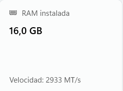
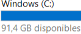
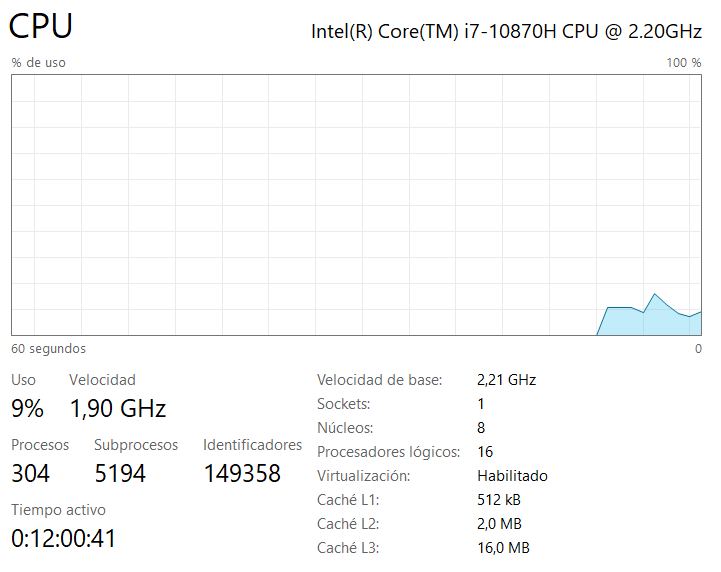
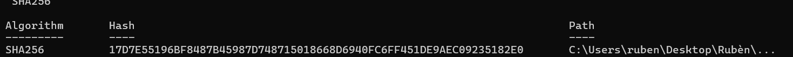
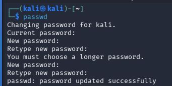
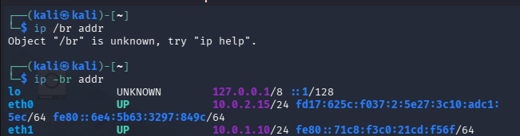
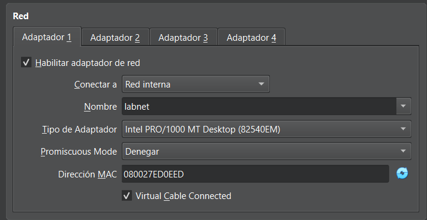
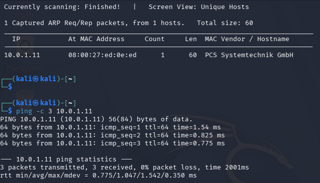
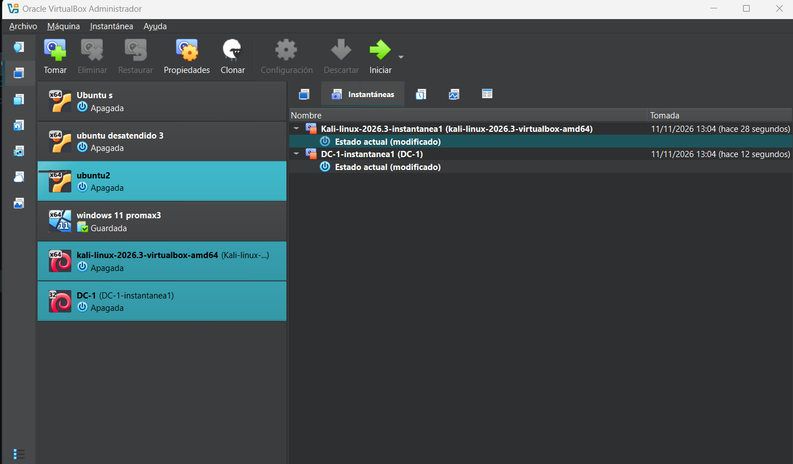

# Practica Laboratorio ataque simulado

Hecho por Rubén Cortés Bellido

---

## Hito 1 · Comprobar los requisitos

Comprobando RAM.

---
## Hito 1 · Comprobar los requisitos
 
Comprobando Disco duro.

---
## Hito 1 · Comprobar los requisitos

Comprobando Virtualización de CPU.

---
## Hito 2 · Instalar VirtualBox e importar Kali
Verificacion del hash. 

---
## Hito 2 · Instalar VirtualBox e importar Kali
Cambio de contraseña en la maquina kali (paswd). 

---
## Hito 3 · Crear la red aislada labnet
Comprobacion de que tiene dirección en las dos redes. 

---
## Hito 4 · Importar la máquina víctima DC-1
Captura de la configuracion de red de la maquina victima (DC-1). 

---
## Hito 5 · Comprobar la conectividad
Comprobacion de que la maquina se detecta y responde mediante ping. 

---
## Hito 6 · Tomar instantáneas

Toma de instantáneas por motivos de seguridad. 

---
## ¿Por qué DC-1 no debe tener adaptador NAT ni puente?
- ***Aislamiento y seguridad:*** DC-1 es una máquina virtual vulnerable diseñada intencionadamente para este tipo de prácticas. DEbido a esto si se le diera acceso mediante NAT o Adaptador Puente, cualquier fallo, brecha o malware presente en DC-1 podría dejar expuesta nuestra red real o permitir conexiones hacia el exterior de forma no controlada.

- ***Entorno controlado:*** Al usar únicamente una red interna, garantizamos que el tráfico del ataque y de la víctima se quede estrictamente dentro de un entorno seguro y aislado en nuestro ordenador.

---
## ¿Para qué sirve el servidor DHCP que creaste en H3?
- ***Reparto automático de IPs:*** Una red interna pura en VirtualBox no incluye por defecto un servicio que asigne direcciones IP de manera automática (no como en el caso de las NAT).

- ***Comunicación sin configuración manual:*** El comando de VBoxManage crea un servidor DHCP en esa red aislada para que, cuando enciendas Kali o DC-1 conectadas a labnet, reciban automáticamente una IP dentro del rango configurado por nosotros sin que tengamos que configurar las interfaces de red una a una por máquina.

---
## ¿Qué hacen netdiscover y ping, y qué información te dio cada uno?
- ***netdiscover:***

    - **Qué hace:** Es una herramienta de descubrimiento de hosts en redes locales mediante el envío de peticiones ARP. Escanea todo el rango de red indicado para ver qué direcciones IP están respondiendo.

    - **Información obtenida:** Me permitió descubrir los dispositivos activos en la red labnet, revelando la dirección IP y la dirección física/MAC correspondiente a la máquina víctima DC-1.
---
## ¿Qué hacen netdiscover y ping, y qué información te dio cada uno?
- ***ping:***

    - **Qué hace:** Envía paquetes de control a una dirección IP específica para comprobar si hay conectividad bidireccional y medir el tiempo de respuesta.

    - **Información obtenida:** Me confirmó que la máquina Kali tenía comunicación directa, estable y sin pérdida de paquetes con DC-1, verificando que la red aislada funcionaba a la perfección.
